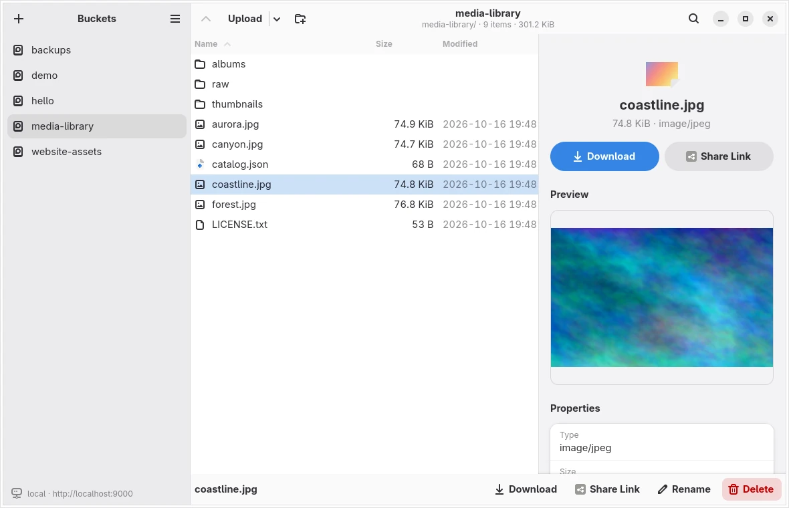
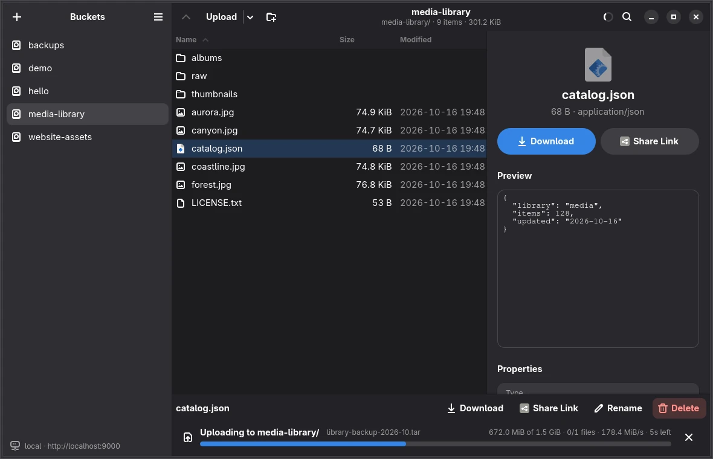

# Larder

A desktop app for browsing and managing S3-compatible object storage: Amazon S3, RustFS, MinIO, Ceph and more.
Built with Rust, GTK 4 and libadwaita.



Browse buckets and folders, upload files and folders by dragging them in (large files use multipart uploads
with progress), download, rename, delete, preview text and images, and share objects with expiring links.



## Build

Needs GTK ≥ 4.14 and libadwaita ≥ 1.6 (e.g. `libgtk-4-dev libadwaita-1-dev` on Debian/Ubuntu).

```sh
cargo run --release
```

More in [docs/usage.md](docs/usage.md) (features, shortcuts, configuration) and
[docs/development.md](docs/development.md) (building, tests, CI).
